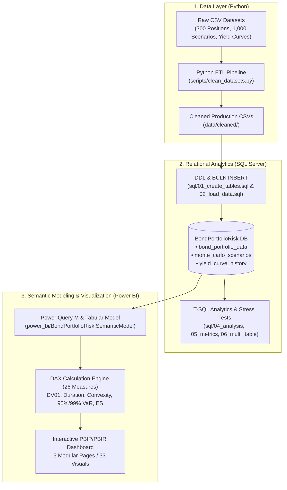

# Fixed-Income Bond Portfolio Risk & Convexity Analytics Platform

[](https://github.com/vikas12134/bond-portfolio-risk-analytics)
[](https://www.microsoft.com/en-us/sql-server)
[](https://www.python.org/)
[](https://powerbi.microsoft.com/)
[](LICENSE)

An institutional-grade Fixed-Income Risk Analytics platform evaluating a **multi-currency portfolio of 300 bond holdings valued at ₹32.06M**.

The platform provides end-to-end fixed income modeling: from **Python automated data engineering** and **Microsoft SQL Server relational analytics** to **second-order interest rate sensitivities (Duration, Convexity, DV01)**, **key rate duration mapping**, and a **1,000-scenario Monte Carlo simulation** computing empirical 95% and 99% **Value-at-Risk (VaR)** and **Expected Shortfall (CVaR)** visualized across an interactive **Power BI (PBIP/PBIR) dashboard suite**.

---

## Technical Architecture & Workflow



---

## Technologies Used

| Technology | Role & Responsibility |
|---|---|
| **Python 3.10+** (Pandas, NumPy) | Data ingestion, type enforcement, schema validation, and null preservation for optionality. |
| **Microsoft SQL Server 2022** (T-SQL) | 3NF relational warehouse, primary keys, check constraints, analytical CTEs, window functions. |
| **Microsoft Power BI Desktop** (PBIP / PBIR) | Tabular Data Model (TMSL `model.bim`), Power Query M, and 26 verified production DAX measures. |
| **Git & GitHub** | Modular source control with automated `.gitignore` rules excluding binary tabular caches (`.abf`). |

---

## Key Portfolio Risk Metrics

All calculations have been validated across the 300-position institutional portfolio:

| Category | Quantitative Metric | Mathematical Methodology | Validated Value |
|---|---|---|:---:|
| **Valuation** | **Total Portfolio Market Value** | $\sum \text{MarketValue\_INR}$ | **₹32,059,345.97** |
| | **Total Holdings** | Distinct bond count | **300 Positions** |
| | **Weighted Average Coupon** | $\sum (\text{Coupon} \times \text{MV}) / \sum \text{MV}$ | **6.8544%** |
| | **Weighted Average YTM** | $\sum (\text{YTM} \times \text{MV}) / \sum \text{MV}$ | **7.1218%** |
| **Sensitivity** | **Portfolio Effective Duration** | $\sum (\text{EffDur} \times \text{MV}) / \sum \text{MV}$ | **4.2038 Years** |
| | **Portfolio Effective Convexity** | $\sum (\text{EffConv} \times \text{MV}) / \sum \text{MV}$ | **44.0315** |
| | **Total Portfolio DV01** | Monetary loss for $+1\text{ bp}$ yield increase | **₹13,478.92 / bp** |
| **Rate Shocks** | **Downward Shock (-100 bps)** | Price change gain under rate drop | **+₹1,418,124.56 (+4.42%)** |
| | **Upward Shock (+100 bps)** | Price change loss under rate hike | **-₹1,276,866.02 (-3.98%)** |
| **Monte Carlo VaR** | **95% 1-Day VaR (INR)** | 5th percentile scenario outcome (50/1000) | **-₹1,983,083.13 (-6.19%)** |
| | **95% Expected Shortfall (CVaR)** | Mean loss beyond 95% VaR threshold | **-₹2,377,153.69 (-7.41%)** |
| | **99% 1-Day VaR (INR)** | 1st percentile scenario outcome (10/1000) | **-₹2,600,761.77 (-8.11%)** |
| | **99% Expected Shortfall (CVaR)** | Mean loss beyond 99% VaR threshold | **-₹2,999,457.15 (-9.36%)** |

> **Key Insight:** Positive convexity ($+44.03$) provides favorable return asymmetry: a $-100\text{ bps}$ rate rally yields a **$+₹1.42\text{M}$** gain, whereas an equivalent $+100\text{ bps}$ rate sell-off causes a smaller loss of **$-₹1.28\text{M}$**.

---

## Power BI Dashboard Pages

The report is structured using the modern **Power BI Project (`.pbip`)** and **Enhanced Report Format (`.pbir`)**, with 33 visual containers across 5 pages:

1. **Portfolio Overview:** Executive KPI summary cards (Market Value, Duration, Convexity, Yield), Currency exposure donut chart, Sector/Rating treemap, Annual maturity ladder (2025–2063), and interactive Currency slicer.
2. **Portfolio Composition:** Top 10 Issuers ranked bar chart (GoI 21.6%, US Treasury 10.7%, Muthoot 5.9%), Credit Rating donut chart, Sector slicer, and detailed Issuer Risk Matrix table.
3. **Risk & Interest Rate Sensitivity:** Total DV01 card, Dynamic rate shock tornado chart ($\pm 50, \pm 100, \pm 200\text{ bps}$), Key Rate Bucket slicer (`0-1Y` to `20Y+`), and Duration vs. Convexity scatter plot.
4. **Yield Curve Analysis:** Sovereign benchmark term structure multi-line chart (Zero Rate & Par Yield across $3\text{M}$–$30\text{Y}$ tenors), Observation Date slicer, Key Rate Bucket spread chart, and Sector Z-spread comparisons.
5. **Monte Carlo Simulation & VaR:** 95%/99% VaR and Expected Shortfall KPI cards, 1,000-scenario P&L frequency distribution, Parallel Shift vs. P&L response curve, and Duration vs. Convexity P&L decomposition.

*(Note: Raw dashboard export screenshots are preserved in the [`screenshots/`](screenshots/) directory).*

---

## Project Directory Structure

```
├── .gitignore                             # Production Git ignore rules (excludes .abf cache and local settings)
├── LICENSE                                # MIT Open-Source License
├── README.md                              # Project documentation
├── requirements.txt                       # Python dependencies (pandas, numpy)
├── data/                                  # Raw & cleaned CSV datasets
│   ├── raw/                               # Original CSVs (300 positions, 1000 scenarios, yield curves)
│   └── cleaned/                           # Production-cleaned CSV datasets
├── docs/                                  # Internship problem statement & rubric
├── power_bi/                              # Power BI Project (PBIP + PBIR)
│   ├── BondPortfolioRisk.pbip             # Master Power BI Project launcher
│   ├── dax_measures_reference.dax         # Production reference formulas for all 26 DAX measures
│   ├── power_query_sources.m              # Power Query M extraction queries
│   ├── BondPortfolioRisk.Report/          # PBIR report layout & 33 visual definitions
│   └── BondPortfolioRisk.SemanticModel/   # Tabular Data Model (model.bim & diagramLayout.json)
├── reports/                               # Validation, audit, and architecture markdown reports
├── screenshots/                           # Preserved Power BI dashboard export screenshots
├── scripts/                               # Data engineering scripts (clean_datasets.py)
└── sql/                                   # Numbered analytical SQL scripts (01 to 06)
```

---

## Quick Setup & Reproduction

### Prerequisites
- Python 3.10+, Microsoft SQL Server 2019/2022, Microsoft Power BI Desktop (June 2024+)

### 1. Clone & Set Up Python
```bash
git clone https://github.com/vikas12134/bond-portfolio-risk-analytics.git
cd bond-portfolio-risk-analytics
python -m venv venv
venv\Scripts\activate
pip install -r requirements.txt
```

### 2. Database & Data Loading
1. Open SSMS or `sqlcmd` and run `sql/01_create_tables.sql` to create database `BondPortfolioRisk`.
2. Update local file paths in `sql/02_load_data.sql` and execute to load all 3 datasets.
3. Run `sql/04_bond_portfolio_analysis.sql`, `sql/05_bond_portfolio_metrics.sql`, and `sql/06_multi_table_analysis.sql`.

### 3. Open Power BI Dashboard
1. Open `power_bi/BondPortfolioRisk.pbip` in **Power BI Desktop**.
2. Click **Home > Refresh** to connect to SQL Server (`localhost` / `.`). All 5 pages will populate immediately.

---

## License

This project is licensed under the [MIT License](LICENSE).
