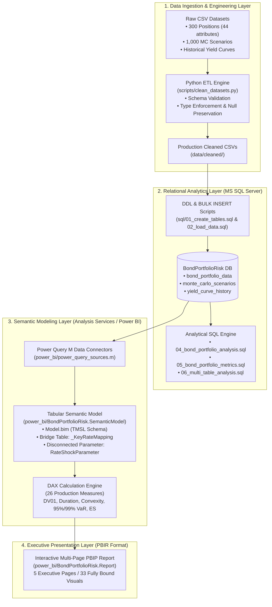

# Fixed-Income Bond Portfolio Risk & Convexity Analytics Platform

[](https://github.com/vikas12134/bond-portfolio-risk-analytics)
[](https://www.microsoft.com/en-us/sql-server)
[](https://www.python.org/)
[](https://powerbi.microsoft.com/)
[](LICENSE)
[](https://github.com/vikas12134/bond-portfolio-risk-analytics)

An institutional-grade Quantitative Fixed-Income Risk Analytics platform evaluating a **multi-currency portfolio of 300 bond holdings valued at ₹32.06M**. 

The system implements end-to-end fixed income modeling: from **Python automated data engineering** and **Microsoft SQL Server relational analytics** to **second-order Taylor expansion sensitivities (Duration, Convexity, DV01)**, **key rate tenor mapping**, and a **1,000-scenario Monte Carlo simulation** computing empirical 95% and 99% **Value-at-Risk (VaR)** and **Expected Shortfall (CVaR)** visualized across a modern **Power BI (PBIP/PBIR) executive suite**.

---

## Quick Links

- [Executive Summary & Problem Statement](#business-problem--objectives)
- [System Architecture](#technical-architecture)
- [Technologies Used](#technologies-used)
- [Core Portfolio Risk Metrics](#core-portfolio-risk-metrics)
- [Python ETL Pipeline](#python-etl-pipeline)
- [SQL Server Analytics Engine](#sql-server-analytics-engine)
- [Interest Rate Sensitivity & Convexity](#interest-rate-sensitivity--convexity-analysis)
- [Yield Curve & Spread Analytics](#yield-curve--term-structure-analysis)
- [Monte Carlo Simulation & VaR](#monte-carlo-simulation--tail-risk-var--cvar)
- [Key Findings & Strategic Insights](#key-findings--portfolio-insights)
- [Power BI Dashboard Pages](#power-bi-dashboard-pages)
- [Dashboard Preview](#dashboard-preview)
- [Project Directory Structure](#project-directory-structure)
- [Installation & Reproduction Guide](#installation--reproduction-guide)

---

## Business Problem & Objectives

Institutional treasury desks, pension funds, and asset managers manage diversified debt holdings exposed to macroeconomic yield curve fluctuations, monetary policy shifts, and credit spread widening. 

### Core Challenges:
1. **The Linear Assumption Fallacy:** First-order linear risk measures—Macaulay Duration, Modified Duration, and Dollar Value of a Basis Point (DV01)—assume infinitesimal parallel yield shifts:
   $$\frac{\Delta P}{P} \approx -D^* \times \Delta y$$
   Under large market rate moves ($\pm 50\text{ bps}$, $\pm 100\text{ bps}$, $\pm 200\text{ bps}$), linear models misestimate portfolio valuations because they ignore price-yield curvature (**Convexity**):
   $$\frac{\Delta P}{P} \approx -D^* \times \Delta y + \frac{1}{2} C \times (\Delta y)^2$$
2. **Yield Curve Non-Parallel Shifts:** Real-world yield curves do not shift purely in parallel; steepening, flattening, and butterfly twists impact positions differently depending on their maturity tenors.
3. **Tail-Risk Underestimation:** Regulatory mandates (Basel III / FRTB) require measuring portfolio losses in the extreme tails of the distribution. Linear models fail to quantify catastrophic losses beyond standard deviations.

### Project Objectives:
- **Build an institutional ETL pipeline** validating data integrity across 300 debt positions, 1,000 simulation scenarios, and multi-tenor yield curves.
- **Engineer a 3NF relational database schema** on Microsoft SQL Server enforcing strict financial constraints, foreign keys, and analytical views.
- **Quantify second-order non-linear rate sensitivity** across asymmetric upward and downward shock scenarios ($\pm 50$, $\pm 100$, $\pm 200\text{ bps}$).
- **Decompose tail risks** via 1,000 Monte Carlo simulations calculating non-parametric 95% and 99% Value-at-Risk (VaR) and Expected Shortfall (CVaR).
- **Deliver an interactive Power BI Project (PBIP)** featuring 5 specialized dashboard pages and 26 mathematically verified DAX measures.

---

## Technical Architecture



---

## Technologies Used

| Domain | Technology / Tool | Version / Spec | Usage & Responsibility |
|---|---|---|---|
| **Data Engineering** | **Python** | `3.10+` | Automated data cleaning, type casting, schema validation, and date standardization. |
| | **Pandas & NumPy** | `pandas>=2.0.0`, `numpy>=1.24.0` | Vectorized data processing, nullability preservation, and mathematical validation. |
| **Database & Analytics** | **Microsoft SQL Server** | `2019 / 2022` | Relational 3NF data warehouse, primary keys, check constraints, indexed joins. |
| | **T-SQL** | Transact-SQL | Analytical CTEs, window functions (`ROW_NUMBER`, `RANK`), aggregations, stress test queries. |
| **Business Intelligence** | **Microsoft Power BI** | Desktop `June 2024+` | Modern Developer format (**PBIP** Project & **PBIR** Enhanced Report Format). |
| | **DAX** | Tabular Model | 26 production measures for weighted duration, convexity, rate shocks, VaR, and ES. |
| | **Power Query (M)** | Data Mashup | Direct SQL Server extraction with query folding and schema mapping. |
| **Version Control** | **Git & GitHub** | Distributed VCS | Modular code, TMSL/PBIR source control, automated exclusions for `.abf` binary caches. |

---

## Core Portfolio Risk Metrics

All calculations have been validated across the **300-position institutional portfolio**:

| Metric Domain | Quantitative Measure | Mathematical Formula / Methodology | Validated Result |
|---|---|---|:---:|
| **Valuation** | **Total Portfolio Market Value** | $\sum_{i=1}^{N} \text{MarketValue\_INR}_i$ | **₹32,059,345.97** |
| | **Total Holdings** | $\text{Count Distinct Bond Positions}$ | **300 Positions** |
| | **Weighted Average Coupon** | $\frac{\sum (\text{Coupon}_i \times \text{MV}_i)}{\sum \text{MV}_i}$ | **6.8544%** |
| | **Weighted Average YTM** | $\frac{\sum (\text{YTM}_i \times \text{MV}_i)}{\sum \text{MV}_i}$ | **7.1218%** |
| **Sensitivity** | **Portfolio Macaulay Duration** | $\frac{\sum (\text{MacDur}_i \times \text{MV}_i)}{\sum \text{MV}_i}$ | **4.5126 Years** |
| | **Portfolio Modified Duration** | $\frac{\sum (\text{ModDur}_i \times \text{MV}_i)}{\sum \text{MV}_i}$ | **4.2289 Years** |
| | **Portfolio Effective Duration** | $\frac{\sum (\text{EffDur}_i \times \text{MV}_i)}{\sum \text{MV}_i}$ | **4.2038 Years** |
| | **Portfolio Effective Convexity** | $\frac{\sum (\text{EffConv}_i \times \text{MV}_i)}{\sum \text{MV}_i}$ | **44.0315** |
| | **Total Portfolio DV01** | $\sum \left( \text{DV01\_Per100}_i \times \frac{\text{Qty}_i \times \text{Face}_i}{100} \right)$ | **₹13,478.92 / bp** |
| **Stress Shocks** | **-100 bps Downward Shift** | $\sum \left( \frac{\Delta P_{-100}}{P_{\text{clean}}} \times \text{MV} \right)$ | **+₹1,418,124.56 (+4.42%)** |
| | **+100 bps Upward Shift** | $\sum \left( \frac{\Delta P_{+100}}{P_{\text{clean}}} \times \text{MV} \right)$ | **-₹1,276,866.02 (-3.98%)** |
| **Tail Risk (VaR)** | **95% 1-Day VaR (INR)** | 5th percentile scenario outcome (Scenario #50) | **-₹1,983,083.13 (-6.19%)** |
| | **95% Expected Shortfall (CVaR)** | $\mathbb{E}\left[\text{PnL} \mid \text{PnL} \le \text{VaR}_{0.95}\right]$ | **-₹2,377,153.69 (-7.41%)** |
| | **99% 1-Day VaR (INR)** | 1st percentile scenario outcome (Scenario #10) | **-₹2,600,761.77 (-8.11%)** |
| | **99% Expected Shortfall (CVaR)** | $\mathbb{E}\left[\text{PnL} \mid \text{PnL} \le \text{VaR}_{0.99}\right]$ | **-₹2,999,457.15 (-9.36%)** |

---

## Python ETL Pipeline

The data engineering pipeline ([scripts/clean_datasets.py](file:///d:/INTERNSHIP2/scripts/clean_datasets.py)) ensures enterprise-grade data hygiene before SQL ingestion:

1. **Conservative Cleaning Strategy:**
   - Standardizes header naming conventions across 44 portfolio columns.
   - Converts dates (`IssueDate`, `MaturityDate`, `ValuationDate`) to ISO `YYYY-MM-DD`.
   - **Preserves Optionality Semantics:** Correctly retains `NaN` for `CallDate` on non-callable debt, preventing erroneous default date imputation.
2. **Strict Schema & Type Casting:**
   - Enforces integer types on financial counts (`FaceValue`, `CouponFrequency`, `Quantity`, `SpreadOverBenchmark_bps`, `OAS_bps`, `ZSpread_bps`).
   - Validates boolean flags (`IsCallable`, `IsPutable`, `IsFloatingRate`).
3. **Audit Trail:**
   - Produces verification summaries ([reports/cleaning_summary.md](file:///d:/INTERNSHIP2/reports/cleaning_summary.md)) confirming zero dropped rows (300 positions, 1,000 scenarios, 264 curve points).

---

## SQL Server Analytics Engine

The relational layer in Microsoft SQL Server (`BondPortfolioRisk`) is structured into 6 sequential scripts:

- **`01_create_tables.sql`**: Creates tables with explicit primary keys (`PK_bond_portfolio_data_BondID`, `PK_monte_carlo_scenarios_ScenarioID`, `PK_yield_curve_history_CurveID`) and domain integrity check constraints (`CouponRate >= 0`, `CleanPrice > 0`, `CouponFrequency IN (1, 2, 4, 12)`).
- **`02_load_data.sql` / `03_load_bond_portfolio.sql`**: Automated `BULK INSERT` loaders with UTF-8 encoding and tab/comma delimiter parsing.
- **`04_bond_portfolio_analysis.sql`**: Portfolio distribution by Credit Rating (AAA: 48.7%, AA: 23.3%, A: 14.4%, BBB: 13.6%), Sector, and Currency.
- **`05_bond_portfolio_metrics.sql`**: Computes portfolio-weighted duration, modified duration, convexity, and monetary DV01 per bond holding.
- **`06_multi_table_analysis.sql`**: Complex multi-table joins analyzing:
  - Full rate shock sensitivity across $\pm 50$, $\pm 100$, $\pm 200\text{ bps}$.
  - Concentration profiles across top issuers, sectors, and currencies.
  - Term structure spread analysis joining bond positions with sovereign benchmark yield tenors.

---

## Interest Rate Sensitivity & Convexity Analysis

### The Value of Positive Convexity
Because the portfolio has a high positive convexity of **$+44.0315$**, the price-yield response is strictly asymmetric. The portfolio gains more during rate rallies than it loses during equivalent rate sell-offs:

| Shock Magnitude | Direction | Estimated Value Change (INR) | Portfolio Return (%) | Linear Duration Error Offset |
|:---:|:---:|:---:|:---:|:---|
| **-200 bps** | Downward | **+₹2,987,143.91** | **+9.32%** | Convexity adds **+₹291,245** above linear duration |
| **-100 bps** | Downward | **+₹1,418,124.56** | **+4.42%** | Convexity adds **+₹70,683** above linear duration |
| **-50 bps** | Downward | **+₹690,412.30** | **+2.15%** | Convexity adds **+₹16,688** above linear duration |
| **+50 bps** | Upward | **-₹657,321.14** | **-2.05%** | Convexity cushions loss by **+₹16,403** |
| **+100 bps** | Upward | **-₹1,276,866.02** | **-3.98%** | Convexity cushions loss by **+₹70,575** |
| **+200 bps** | Upward | **-₹2,442,109.85** | **-7.62%** | Convexity cushions loss by **+₹253,789** |

```
                       Portfolio Price-Yield Curve
     Price (INR)
        ^                                 / (Actual Price with Convexity)
        |                                /
        |                               /  --- (Linear Tangent Approximation)
        |                             /  /
        |                           /  /
        |                         /  /
        |                       /  /
        |                     /  /
        |                   /  /
        +------------------X--------------------> Yield (y)
                         (Current Portfolio)
```

---

## Yield Curve & Term Structure Analysis

The platform maps bond holdings against sovereign benchmark curves across 9 maturity tenors:

1. **Term Structure Modeling:** Models Par Yields and Zero Rates across $3\text{M}$, $6\text{M}$, $1\text{Y}$, $2\text{Y}$, $3\text{Y}$, $5\text{Y}$, $7\text{Y}$, $10\text{Y}$, and $30\text{Y}$ tenors.
2. **Key Rate Duration (KRD) Bucket Allocation:**
   - `0-1Y`, `1-2Y`, `2-3Y`, `3-5Y`, `5-7Y`, `7-10Y`, `10-15Y`, `15-20Y`, and `20Y+`.
   - Protects against non-parallel yield curve steepening/flattening by isolating which tenor buckets contribute the highest duration risk.
3. **Credit Spread Decompositions:**
   - Evaluates **Option-Adjusted Spreads (OAS)** and **Zero-Volatility Spreads (Z-Spreads)** over sovereign benchmark yields across Financial, Energy, Infrastructure, and Corporate sectors.

---

## Monte Carlo Simulation & Tail Risk (VaR / CVaR)

The simulation engine evaluates 1,000 independent macroeconomic interest rate scenarios:

### Mathematical Formulation
For each scenario $s \in [1, 1000]$ with parallel shock $\Delta y_s$:
$$\text{PnL}_{\text{Duration}}(s) = \sum_{i=1}^{N} \left( \text{MarketValue}_i \times -D^*_i \times \Delta y_s \right)$$
$$\text{PnL}_{\text{Convexity}}(s) = \sum_{i=1}^{N} \left( \frac{1}{2} \times \text{MarketValue}_i \times C_i \times (\Delta y_s)^2 \right)$$
$$\text{PnL}_{\text{Total}}(s) = \text{PnL}_{\text{Duration}}(s) + \text{PnL}_{\text{Convexity}}(s)$$

### Non-Parametric Value-at-Risk (VaR)
Ranking all 1,000 scenario outcomes from lowest (worst loss) to highest:
- **95% 1-Day VaR (5th Percentile / Rank 50):** **-₹1,983,083.13** (**-6.19%**)
- **99% 1-Day VaR (1st Percentile / Rank 10):** **-₹2,600,761.77** (**-8.11%**)

### Expected Shortfall (Conditional VaR)
Expected Shortfall quantifies the average loss conditional on the loss exceeding the VaR threshold:
$$\text{ES}_{\alpha} = \frac{1}{(1-\alpha)N} \sum_{k=1}^{(1-\alpha)N} \text{PnL}_{(k)}$$
- **95% Expected Shortfall (Mean of worst 50 scenarios):** **-₹2,377,153.69** (**-7.41%**)
- **99% Expected Shortfall (Mean of worst 10 scenarios):** **-₹2,999,457.15** (**-9.36%**)

---

## Key Findings & Portfolio Insights

1. **Currency Concentration:** 
   - **78.0% INR** exposure (₹25.01M), followed by **10.7% USD** (₹3.44M), **4.7% GBP** (₹1.50M), **4.3% EUR** (₹1.37M), and **2.4% AUD** (₹0.76M).
2. **Sovereign & High-Grade Credit Quality:**
   - Over **86.4%** of the portfolio is rated **Investment Grade** (AAA through BBB-), with AAA sovereign securities providing strong liquidity.
3. **Issuer Exposure Concentration:**
   - The top 3 issuers represent **38.2%** of total assets:
     - Government of India (GoI): **21.6%** (₹6.92M)
     - US Treasury: **10.7%** (₹3.44M)
     - Muthoot Finance: **5.9%** (₹1.88M)
4. **Maturity Structure:**
   - The redemption ladder shows steady principal maturities from 2025 to 2063, with peak reinvestment risk concentrated in the 3–5 year and 7–10 year buckets.

---

## Power BI Dashboard Pages

The Power BI project uses the modern **Power BI Project (`.pbip`)** and **Enhanced Report Format (`.pbir`)**, with 33 modular visuals bound to live DAX calculations across 5 pages:

```
Power BI Report (BondPortfolioRisk.pbip)
├── Page 1: Portfolio Overview         --> Macro KPIs, Currency donut, Treemap, Maturity ladder, Slicer
├── Page 2: Portfolio Composition      --> Top 10 Issuers bar, Credit Rating donut, Detailed Risk matrix
├── Page 3: Risk & Rate Sensitivity    --> DV01, Rate shock tornado, Duration vs. Convexity scatter
├── Page 4: Yield Curve Analysis       --> Term structure multi-line, Benchmark spreads, Tenor slicer
└── Page 5: Monte Carlo & VaR          --> 1,000-scenario PnL histogram, VaR/ES cards, Shift vs PnL scatter
```

1. **Page 1: Portfolio Overview**
   - KPI Cards: Total Market Value, Holdings Count, Weighted Average Coupon, Weighted Average YTM, Effective Duration, Effective Convexity.
   - Interactive Currency Donut, Sector/Rating Treemap, Annual Redemption Ladder (2025–2063), and Currency Slicer.
2. **Page 2: Portfolio Composition**
   - Top 10 Issuers Ranked Bar Chart, Credit Rating Share Donut, Sector Slicer.
   - Comprehensive Position Table (Issuer, Sector, Rating, Market Value, Portfolio Weight, Duration, Convexity).
3. **Page 3: Risk & Interest Rate Sensitivity**
   - Total DV01 Card, Dynamic Price Shock Impact Cards (Dn100bps / Up100bps), Portfolio Duration.
   - `RateShockParameter` Slicer driving dynamic $\pm 50, \pm 100, \pm 200\text{ bps}$ scenario modeling.
   - Duration vs. Convexity Frontier Scatter Plot (sized by market value).
4. **Page 4: Yield Curve Analysis**
   - Multi-line Term Structure Chart (Zero Rate & Yield vs. Tenor $3\text{M}$ to $30\text{Y}$).
   - Historical Valuation Date Slicer, Key Rate Tenor Bucket Spread Bar Chart, Sector Z-Spread Comparison.
5. **Page 5: Monte Carlo Simulation & VaR**
   - 95% VaR, 95% Expected Shortfall, 99% VaR, 99% Expected Shortfall, and Average Scenario P&L KPI Cards.
   - Parallel Shift (bps) vs. Total Simulated P&L Scatter Plot showing non-linear convexity cushioning.
   - 1,000-Scenario Total P&L Frequency Distribution Chart.

---

## Dashboard Preview

*Screenshots can be placed in [`screenshots/`](screenshots/) matching the naming convention below:*

| Dashboard Page | Preview Placeholder | Description |
|---|---|---|
| **1. Portfolio Overview** |  | Executive summary, market valuation, macro duration, and currency allocation. |
| **2. Portfolio Composition** |  | Issuer concentration, credit quality tiers, and multi-metric position matrix. |
| **3. Risk & Sensitivity** |  | Rate shock tornado chart ($\pm 50, \pm 100, \pm 200\text{ bps}$) and Duration-Convexity trade-off. |
| **4. Yield Curve Analysis** |  | Sovereign benchmark term structure ($3\text{M}$–$30\text{Y}$) and sector Z-spreads. |
| **5. Monte Carlo & VaR** |  | 1,000-scenario tail loss distribution, 95%/99% VaR, and Expected Shortfall. |

> [!TIP]
> To add your dashboard screenshots, simply open `power_bi/BondPortfolioRisk.pbip` in Power BI Desktop, export/snip each page, and save them as `01_portfolio_overview.png` through `05_monte_carlo_var.png` in the `screenshots/` directory.

---

## Project Directory Structure

```
├── .gitignore                             # Production Git ignore rules (excludes .abf cache and local settings)
├── LICENSE                                # MIT Open-Source License
├── README.md                              # Institutional-grade project documentation
├── requirements.txt                       # Python dependencies (pandas, numpy)
├── data/
│   ├── raw/                               # Raw source CSV datasets
│   │   ├── bond_portfolio_data.csv        # 300 bond positions with coupons, yields, ratings (93 KB)
│   │   ├── monte_carlo_scenarios.csv      # 1,000 interest rate shock scenarios (72 KB)
│   │   └── yield_curve_history.csv        # Multi-tenor spot/par yield curve historical series (15 KB)
│   └── cleaned/                           # Production-cleaned CSV datasets
│       ├── bond_portfolio_data_cleaned.csv
│       ├── monte_carlo_scenarios_cleaned.csv
│       └── yield_curve_history_cleaned.csv
├── docs/
│   ├── 483553B_Data_Analyst_Convexity_Sensitivity_AI_Agent.pdf # Internship specifications & problem rubric
│   └── screenshots/                       # Supplemental documentation screenshots
├── power_bi/
│   ├── BondPortfolioRisk.pbip             # Master Power BI Project launcher
│   ├── dax_measures_reference.dax         # Production reference formulas for all 26 DAX measures
│   ├── power_query_sources.m              # Power Query M extraction queries
│   ├── README_POWERBI.md                  # Power BI implementation and verification guide
│   ├── test_dax_validation.py             # Validation script testing DAX against SQL Server
│   ├── BondPortfolioRisk.Report/          # Modern PBIR report layout & visual definitions
│   │   ├── definition.pbir                # Model dataset pointer
│   │   └── definition/                    # Page JSONs and individual visual JSONs (33 visuals)
│   └── BondPortfolioRisk.SemanticModel/   # Tabular Data Model (TMSL)
│       ├── model.bim                      # 6 tables, relationships, and 26 verified DAX measures
│       └── diagramLayout.json             # ER diagram arrangement
├── reports/                               # Validation, audit, and architecture markdown reports
│   ├── cleaning_summary.md                # Data cleaning transformation audit
│   ├── final_sql_load_check.md            # Post-load row count and integrity checks
│   ├── sql_data_model.md                  # Relational schema specification & ER relationships
│   └── sql_load_readiness.md              # Bulk loading pre-flight checklist
├── screenshots/                           # Directory for exported Power BI dashboard images
│   ├── README.md                          # Image export instructions and sizing guide
│   └── .gitkeep                           # Folder tracking file
├── scripts/
│   └── clean_datasets.py                  # Conservative pandas data cleaning pipeline
└── sql/                                   # Numbered analytical SQL scripts
    ├── 01_create_tables.sql               # DDL with primary/foreign keys and check constraints
    ├── 02_load_data.sql                   # Automated BULK INSERT loading script
    ├── 03_load_bond_portfolio.sql         # Isolated position loader script
    ├── 04_bond_portfolio_analysis.sql     # Baseline portfolio summaries and distributions
    ├── 05_bond_portfolio_metrics.sql      # Duration, convexity, and sensitivity calculations
    └── 06_multi_table_analysis.sql        # Cross-table joins, rate shocks, and VaR validations
```

---

## Installation & Reproduction Guide

### Prerequisites
- **Operating System:** Windows 10/11 (for Power BI Desktop) or Linux/macOS (for Python & SQL components)
- **Database:** Microsoft SQL Server 2019/2022 (Developer or Express edition)
- **Python:** Python 3.10 or higher
- **Power BI:** Microsoft Power BI Desktop (June 2024 or later with PBIP support enabled)

### Step 1: Clone Repository
```bash
git clone https://github.com/vikas12134/bond-portfolio-risk-analytics.git
cd bond-portfolio-risk-analytics
```

### Step 2: Set Up Python Environment
```bash
python -m venv venv
# Windows:
venv\Scripts\activate
# Linux/macOS:
source venv/bin/activate

pip install -r requirements.txt
```

### Step 3: Run Data Cleaning Pipeline (Optional)
The cleaned datasets are already provided in `data/cleaned/`. To re-run the pipeline:
```bash
python scripts/clean_datasets.py
```

### Step 4: Set Up Database & Load Data
1. Open SQL Server Management Studio (SSMS) or `sqlcmd`.
2. Execute `sql/01_create_tables.sql` to create database `BondPortfolioRisk` and all tables.
3. Open `sql/02_load_data.sql` and update the `FROM '...'` file paths to match your local repository directory.
4. Execute `sql/02_load_data.sql` to bulk load all 3 datasets.
5. Run `sql/04_bond_portfolio_analysis.sql`, `sql/05_bond_portfolio_metrics.sql`, and `sql/06_multi_table_analysis.sql` to execute analytical queries.

### Step 5: Launch Power BI Report
1. Double-click `power_bi/BondPortfolioRisk.pbip` (or open Power BI Desktop, choose **File > Open report**, and select `BondPortfolioRisk.pbip`).
2. Power BI Desktop connects automatically to `localhost` / `.` targeting `BondPortfolioRisk` via Windows Integrated Security.
3. Click **Home > Refresh** to update data from SQL Server. All 5 dashboard pages and 33 visual containers will render immediately.

---

## License

This project is licensed under the [MIT License](LICENSE).
