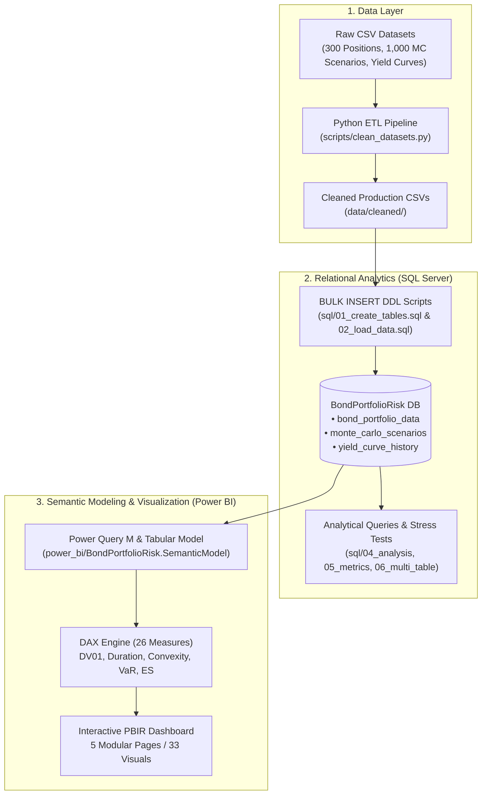

# Bond Portfolio Risk & Convexity Analytics

[](https://www.microsoft.com/en-us/sql-server)
[](https://www.python.org/)
[](https://powerbi.microsoft.com/)
[](LICENSE)

An institutional-grade Fixed Income Portfolio Risk Analytics and Stress Testing platform. This project integrates **Python data engineering**, **Microsoft SQL Server relational analytics**, and a **Power BI Tabular Model (PBIP/PBIR)** to deliver deep insights into bond portfolio valuation, second-order interest rate sensitivities (Duration, Convexity, DV01), key rate exposures, yield curve term structure dynamics, and 1,000-scenario Monte Carlo Value-at-Risk (VaR) and Expected Shortfall (CVaR).

---

## Table of Contents

- [Business Problem](#business-problem)
- [System Architecture](#system-architecture)
- [Key Financial Metrics Summary](#key-financial-metrics-summary)
- [Repository Structure](#repository-structure)
- [SQL Server Analytics Engine](#sql-server-analytics-engine)
- [Python Monte Carlo Simulation](#python-monte-carlo-simulation)
- [Power BI Dashboard Pages](#power-bi-dashboard-pages)
- [Setup & Reproduction Guide](#setup--reproduction-guide)
- [Dashboard Screenshots](#dashboard-screenshots)
- [License](#license)

---

## Business Problem

Fixed-income asset managers, pension funds, and institutional treasury desks manage large portfolios of debt securities subject to complex interest rate, credit spread, and liquidity risks. 

Standard linear approximations (Macaulay Duration, Modified Duration, and DV01) predict price changes assuming small, parallel shifts in the yield curve:

$$\frac{\Delta P}{P} \approx -D^* \times \Delta y$$

However, when markets experience large yield shocks ($\pm 50$, $\pm 100$, $\pm 200\text{ bps}$), non-linear price curvature (**Convexity**) substantially alters portfolio returns:

$$\frac{\Delta P}{P} \approx -D^* \times \Delta y + \frac{1}{2} C \times (\Delta y)^2$$

Furthermore, modern regulatory frameworks (Basel III, FRTB) mandate empirical distribution tail-loss modeling. Linear duration-based risk models underestimate extreme tail losses during market stress events. 

This project solves this challenge by implementing:
1. **Full-revaluation and Taylor-expansion sensitivity modeling** across upward and downward rate shock regimes.
2. **Key rate duration bucket mapping** across 9 maturity tenors (0-1Y to 20Y+) to identify yield curve steepening/flattening vulnerability.
3. **1,000-scenario Monte Carlo simulation** evaluating non-parametric 95% and 99% 1-Day Value-at-Risk (VaR) and Expected Shortfall (Conditional VaR).
4. **Interactive executive dashboards** enabling portfolio managers to drill down from macro portfolio metrics to individual sector, currency, and issuer exposures.

---

## System Architecture



---

## Key Financial Metrics Summary

All metrics are validated against the 300-bond institutional multi-currency portfolio:

| Metric Category | Measure Name | Formula / Methodology | Validated Value |
|---|---|---|:---:|
| **Valuation** | **Total Portfolio Market Value** | $\sum \text{MarketValue\_INR}$ | **₹32,059,345.97** |
| | **Total Holdings** | Distinct bond count | **300 Positions** |
| | **Weighted Average Coupon** | $\sum (\text{Coupon} \times \text{MV}) / \sum \text{MV}$ | **6.8544%** |
| | **Weighted Average YTM** | $\sum (\text{YTM} \times \text{MV}) / \sum \text{MV}$ | **7.1218%** |
| **Sensitivity** | **Portfolio Effective Duration** | $\sum (\text{EffDur} \times \text{MV}) / \sum \text{MV}$ | **4.2038 Years** |
| | **Portfolio Effective Convexity** | $\sum (\text{EffConv} \times \text{MV}) / \sum \text{MV}$ | **44.0315** |
| | **Total Portfolio DV01** | Monetary loss for $+1\text{ bp}$ yield increase | **₹13,478.92 / bp** |
| **Rate Shocks** | **Downward Shock (-100 bps)** | Estimated portfolio value gain | **+₹1,418,124.56 (+4.42%)** |
| | **Upward Shock (+100 bps)** | Estimated portfolio value loss | **-₹1,276,866.02 (-3.98%)** |
| **Monte Carlo VaR** | **95% 1-Day VaR (INR)** | 5th percentile scenario outcome | **-₹1,983,083.13 (-6.19%)** |
| | **95% Expected Shortfall (CVaR)** | Mean loss beyond 95% VaR threshold | **-₹2,377,153.69 (-7.41%)** |
| | **99% 1-Day VaR (INR)** | 1st percentile scenario outcome | **-₹2,600,761.77 (-8.11%)** |
| | **99% Expected Shortfall (CVaR)** | Mean loss beyond 99% VaR threshold | **-₹2,999,457.15 (-9.36%)** |

> [!NOTE]
> Positive portfolio convexity ($+44.03$) creates favorable asymmetry: a $-100\text{ bps}$ rate decrease delivers a **$+₹1.42\text{M}$** gain, whereas an equivalent $+100\text{ bps}$ rate increase causes a smaller loss of **$-₹1.28\text{M}$**.

---

## Repository Structure

```
├── .gitignore                             # Root Git exclusions (Power BI cache, local settings, temp files)
├── README.md                              # Institutional-grade project documentation
├── requirements.txt                       # Core Python dependencies (pandas, numpy)
├── data/
│   ├── raw/                               # Original raw CSV data files
│   │   ├── bond_portfolio_data.csv        # 300 bond positions with coupons, yields, ratings
│   │   ├── monte_carlo_scenarios.csv      # 1,000 interest rate shock simulation scenarios
│   │   └── yield_curve_history.csv        # Multi-tenor spot/par yield curve historical records
│   └── cleaned/                           # Production-cleaned CSV datasets
│       ├── bond_portfolio_data_cleaned.csv
│       ├── monte_carlo_scenarios_cleaned.csv
│       └── yield_curve_history_cleaned.csv
├── docs/
│   ├── 483553B_Data_Analyst_Convexity_Sensitivity_AI_Agent.pdf # Internship specifications & problem brief
│   └── screenshots/                       # Dashboard page screenshots
├── power_bi/
│   ├── BondPortfolioRisk.pbip             # Master Power BI Project launcher
│   ├── dax_measures_reference.dax         # Production reference formulas for all 26 DAX measures
│   ├── power_query_sources.m              # Power Query M extraction queries
│   ├── README_POWERBI.md                  # Power BI implementation and verification guide
│   ├── test_dax_validation.py             # Python validation script checking DAX against SQL Server
│   ├── BondPortfolioRisk.Report/          # Modern PBIR report layout & visual definitions
│   │   ├── definition.pbir                # Model dataset pointer
│   │   └── definition/                    # Page JSONs and individual visual JSONs (33 visuals)
│   └── BondPortfolioRisk.SemanticModel/   # Tabular Data Model (TMSL)
│       ├── model.bim                      # 6 tables, relationships, and DAX calculations
│       └── diagramLayout.json             # ER diagram arrangement
├── reports/                               # Validation, audit, and architecture markdown reports
│   ├── cleaning_summary.md                # Data cleaning transformation audit
│   ├── final_sql_load_check.md            # Post-load row count and integrity checks
│   ├── sql_data_model.md                  # Relational schema specification & ER relationships
│   └── sql_load_readiness.md              # Bulk loading pre-flight checklist
├── scripts/
│   └── clean_datasets.py                  # Conservative pandas data cleaning pipeline
└── sql/                                   # Numbered analytical SQL scripts
    ├── 01_create_tables.sql               # DDL with primary/foreign keys and check constraints
    ├── 02_load_data.sql                   # Automated BULK INSERT loading script
    ├── 03_load_bond_portfolio.sql         # Isolated position loader script
    ├── 04_bond_portfolio_analysis.sql     # Baseline portfolio summaries and distributions
    ├── 05_bond_portfolio_metrics.sql      # Duration, convexity, and sensitivity calculations
    └── 06_multi_table_analysis.sql        # Cross-table joins, rate shocks, and VaR validations
```

---

## SQL Server Analytics Engine

The database tier is designed in Microsoft SQL Server (`BondPortfolioRisk`) adhering to relational 3NF principles:

1. **`01_create_tables.sql`**: Defines relational tables with strict data typing, nullability, primary keys (`PK_bond_portfolio_data_BondID`, `PK_monte_carlo_scenarios_ScenarioID`, `PK_yield_curve_history_CurveID`), and check constraints on yields, prices, and coupon frequencies.
2. **`02_load_data.sql` / `03_load_bond_portfolio.sql`**: Executes bulk inserts from the cleaned CSV files with transactional validation and row-count verification.
3. **`04_bond_portfolio_analysis.sql`**: Computes portfolio allocation across rating tiers (AAA to BBB-), currencies (INR 78.0%, USD 10.7%, GBP 4.7%, EUR 4.3%, AUD 2.4%), and sector groups.
4. **`05_bond_portfolio_metrics.sql`**: Calculates capital-weighted duration, convexity, and monetary DV01 per position and across the portfolio.
5. **`06_multi_table_analysis.sql`**: Performs cross-table analytical queries:
   - **Interest Rate Sensitivity Analysis**: Multi-table modeling of $\pm 50$, $\pm 100$, and $\pm 200\text{ bps}$ shocks using precalculated clean price variations.
   - **Concentration Analysis**: Concentration profiles by Issuer (Top holdings: Government of India 21.6%, US Treasury 10.7%, Muthoot Finance 5.9%), Currency, and BondType.
   - **Benchmark Term Spread & OAS Analysis**: Maps positions against sovereign benchmark curves to evaluate OAS (Option-Adjusted Spread) and Z-Spread distributions.

---

## Python Monte Carlo Simulation

The simulation framework models 1,000 independent interest rate shock scenarios to capture the portfolio's non-linear loss distribution:

- **Scenario Modeling**: Parallel yield shifts ($\Delta y$) applied across the portfolio.
- **P&L Decomposition**:
  $$\text{PnL}_{\text{Total}} = \text{PnL}_{\text{Duration}} + \text{PnL}_{\text{Convexity}}$$
  $$\text{PnL}_{\text{Duration}} = \sum_{i=1}^{N} \left( \text{MV}_i \times -D^*_i \times \Delta y \right)$$
  $$\text{PnL}_{\text{Convexity}} = \sum_{i=1}^{N} \left( \frac{1}{2} \times \text{MV}_i \times C_i \times (\Delta y)^2 \right)$$
- **Value-at-Risk (VaR)**: Empirical non-parametric ranking of scenarios:
  - **95% 1-Day VaR**: 50th worst scenario outcome out of 1,000 (**-₹1.98M** / **-6.19%**).
  - **99% 1-Day VaR**: 10th worst scenario outcome out of 1,000 (**-₹2.60M** / **-8.11%**).
- **Expected Shortfall (CVaR)**: Conditional mean loss strictly beyond the VaR cutoff:
  - **95% Expected Shortfall**: Average of the 50 worst scenarios (**-₹2.38M** / **-7.41%**).
  - **99% Expected Shortfall**: Average of the 10 worst scenarios (**-₹3.00M** / **-9.36%**).

---

## Power BI Dashboard Pages

The Power BI project is structured using the modern **Power BI Project (`.pbip`)** and **Enhanced Report Format (`.pbir`)**, enabling clean source control and automated visual bindings.

### Page 1: Portfolio Overview
- **Executive KPI Cards**: Total Market Value (₹32.06M), Total Holdings (300), Weighted Average Coupon (6.85%), Weighted Average YTM (7.12%), Effective Duration (4.20 yrs), Effective Convexity (44.03).
- **Currency Donut Chart**: Market value share across INR, USD, GBP, EUR, AUD, and JPY.
- **Sector & Rating Treemap**: Hierarchical capital allocation grouped by Sector and detailed by Credit Rating.
- **Maturity Redemption Ladder**: Annual principal redemption bar chart (2025–2063).
- **Interactive Slicers**: Dynamic currency and sector filtering.

### Page 2: Portfolio Composition
- **Top 10 Issuers Bar Chart**: Capital exposure ranked by issuer.
- **Credit Rating Donut Chart**: Investment grade vs. high yield breakdown.
- **Sector Slicer**: Multi-select filter across Financials, Government, Utilities, Energy, etc.
- **Position Risk Matrix**: Multi-level table showing Issuer, Sector, Rating, Positions, Market Value, Portfolio Weight %, Duration, and Convexity.

### Page 3: Risk & Interest Rate Sensitivity
- **Sensitivity KPI Cards**: Total DV01 (₹13,478.92), -100 bps Shock Impact (+₹1.42M), +100 bps Shock Impact (-₹1.28M), Effective Duration.
- **Key Rate Tenor Slicer**: Filters portfolio risks by key rate maturity buckets (`0-1Y` through `20Y+`).
- **Rate Shock Impact Tornado Chart**: Portfolio monetary gain/loss under $\pm 50$, $\pm 100$, and $\pm 200\text{ bps}$ shifts.
- **Duration vs. Convexity Frontier**: Interactive scatter plot mapping position risk tradeoffs sized by market value.

### Page 4: Yield Curve Analysis
- **Benchmark Term Structure Multi-Line Chart**: Sovereign Zero Rate and Par Yield curves plotted across tenors ($3\text{M}$ to $30\text{Y}$).
- **Valuation Date Timeline Slicer**: Historical curve observation dates.
- **Key Rate Bucket Spread Chart**: Net credit spread over benchmark across maturity buckets.
- **Sector Z-Spread Chart**: Average Z-spread and OAS across industry sectors.

### Page 5: Monte Carlo Simulation & VaR
- **Risk Measure KPI Cards**: 95% VaR, 95% Expected Shortfall, 99% VaR, 99% Expected Shortfall, Average Scenario P&L.
- **Parallel Shift vs. P&L Scatter Plot**: Non-linear response curve demonstrating convexity benefits during extreme market yield shocks.
- **1,000-Scenario P&L Distribution**: Simulated total portfolio P&L distribution.
- **Duration vs. Convexity Decomposition**: Visual breakdown isolating linear duration losses from second-order convexity offsets.

---

## Setup & Reproduction Guide

### Prerequisites
- **Operating System:** Windows 10/11 (for Power BI Desktop) or Linux/macOS (for Python & SQL components)
- **Database:** Microsoft SQL Server 2019/2022 (Developer or Express edition)
- **Python:** Python 3.10 or higher
- **Power BI:** Microsoft Power BI Desktop (June 2024 or later with PBIP support enabled)

### Step 1: Clone Repository
```bash
git clone https://github.com/<your-username>/bond-portfolio-risk-analytics.git
cd bond-portfolio-risk-analytics
```

### Step 2: Set Up Python Environment
```bash
python -m venv venv
# Windows:
venv\Scripts\activate
# Linux/macOS:
source venv/bin/activate

pip install -r requirements.txt
```

### Step 3: Run Data Cleaning Pipeline (Optional)
The cleaned datasets are already provided in `data/cleaned/`. To re-run the pipeline:
```bash
python scripts/clean_datasets.py
```

### Step 4: Set Up Database & Load Data
1. Open SQL Server Management Studio (SSMS) or `sqlcmd`.
2. Execute `sql/01_create_tables.sql` to create database `BondPortfolioRisk` and all tables.
3. Open `sql/02_load_data.sql` and update the `FROM '...'` file paths to match your local repository path.
4. Execute `sql/02_load_data.sql` to bulk load all 3 datasets.
5. Run `sql/04_bond_portfolio_analysis.sql`, `sql/05_bond_portfolio_metrics.sql`, and `sql/06_multi_table_analysis.sql` to execute analytical queries.

### Step 5: Launch Power BI Report
1. Double-click `power_bi/BondPortfolioRisk.pbip` (or open Power BI Desktop, choose **File > Open report**, and select `BondPortfolioRisk.pbip`).
2. Power BI Desktop connects automatically to `localhost` / `.` targeting `BondPortfolioRisk` via Windows Integrated Security.
3. Click **Home > Refresh** to update data from SQL Server. All 5 dashboard pages and 33 visual containers will render immediately.

---

## Dashboard Screenshots

*Screenshots can be placed in `docs/screenshots/` and referenced below:*

| Dashboard Page | Preview |
|---|---|
| **1. Portfolio Overview** |  |
| **2. Portfolio Composition** |  |
| **3. Risk & Sensitivity** |  |
| **4. Yield Curve Analysis** |  |
| **5. Monte Carlo & VaR** |  |

---

## License

This project is licensed under the [MIT License](LICENSE).

