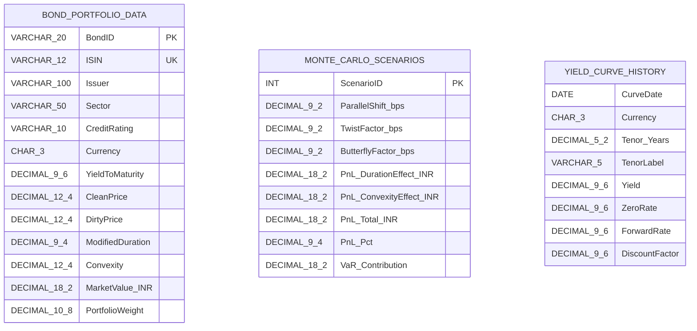

# SQL Server Data Model Report

**Project:** Bond Portfolio Risk & Convexity Analytics  
**Date:** 2026-10-27  
**Dialect:** Microsoft SQL Server (T-SQL)  
**DDL Script:** [sql/01_create_tables.sql](file:///d:/INTERNSHIP2/sql/01_create_tables.sql)  
**Source Data:** Cleaned CSV datasets in [data/cleaned/](file:///d:/INTERNSHIP2/data/cleaned/)

---

## 1. Overview & Design Principles

The database design directly mirrors the structure of the verified, cleaned CSV files in `data/cleaned/`:
1. `dbo.bond_portfolio_data`
2. `dbo.monte_carlo_scenarios`
3. `dbo.yield_curve_history`

### Key Design Principles:
- **Strict Data Integrity:** Precise SQL Server data types (`DECIMAL`, `DATE`, `BIT`, `VARCHAR`, `INT`) chosen to match financial quantities and decimal precision without truncation.
- **Evidence-Based Primary Keys:** Primary keys are strictly defined only where guaranteed and supported by the underlying data.
- **No Artificial Relationships:** Foreign keys are omitted because each table represents an independent analytical dimension; no artificial join columns or synthetic relationships were created.

---

## 2. Table Specifications

### 2.1 Table: `dbo.bond_portfolio_data`

- **Purpose:** Position-level inventory of fixed-income securities within the portfolio. Stores core contractual parameters (issuer, coupon, maturity), valuation metrics (clean/dirty price, accrued interest, market value), and risk sensitivities (modified duration, convexity, DV01, key rate buckets, rate shock price changes).
- **Primary Key:** `PK_bond_portfolio_data` on `BondID` (clustered). Supported by 300 unique IDs across 300 rows.
- **Unique Constraint:** `UQ_bond_portfolio_data_ISIN` on `ISIN`.
- **Foreign Keys:** None.
- **Important Columns:**

| Column Name | SQL Server Data Type | Nullable | Description / Business Meaning |
|---|---|---|---|
| `BondID` | `VARCHAR(20)` | No (PK) | Unique bond identifier (e.g., `ZTFI-0001`). |
| `ISIN` | `VARCHAR(12)` | No (UQ) | International Securities Identification Number. |
| `Issuer` | `VARCHAR(100)` | No | Name of issuing entity (e.g., `Government of India`). |
| `Sector` | `VARCHAR(50)` | No | Industry sector classification (`Government`, `NBFC`, `Banking`, etc.). |
| `CreditRating` | `VARCHAR(10)` | No | Credit rating agency grade (`SOV`, `AAA`, `AA+`, etc.). |
| `Currency` | `CHAR(3)` | No | ISO currency code (`INR`, `USD`, `EUR`, `GBP`, `JPY`, `AUD`). |
| `CouponRate` | `DECIMAL(9, 6)` | No | Annual coupon rate in decimal format (e.g., `0.062000`). |
| `IssueDate` | `DATE` | No | Date of bond origination (`YYYY-MM-DD`). |
| `MaturityDate` | `DATE` | No | Final maturity date (`YYYY-MM-DD`). |
| `ValuationDate` | `DATE` | No | As-of portfolio valuation date (`2024-10-31`). |
| `YieldToMaturity` | `DECIMAL(9, 6)` | No | Yield to maturity (YTM) in decimal format. |
| `CleanPrice` | `DECIMAL(12, 4)` | No | Quoted market clean price per 100 face value. |
| `AccruedInterest` | `DECIMAL(12, 4)` | No | Accrued coupon interest per 100 face value. |
| `DirtyPrice` | `DECIMAL(12, 4)` | No | Settlement dirty price ($\text{Clean} + \text{Accrued}$). |
| `ModifiedDuration`| `DECIMAL(9, 4)` | No | Percentage price sensitivity to parallel yield shift. |
| `Convexity` | `DECIMAL(12, 4)` | No | Second-order rate sensitivity / curvature metric. |
| `DV01_Per100Face` | `DECIMAL(9, 4)` | No | Dollar value of 1 basis point shift per 100 face value. |
| `KeyRateBucket` | `VARCHAR(10)` | No | Maturity segment for key rate duration analysis (`2-3Y`, `20Y+`, etc.). |
| `MarketValue_INR` | `DECIMAL(18, 2)` | No | Total position market value converted to INR. |
| `PortfolioWeight` | `DECIMAL(10, 8)` | No | Relative weight in total portfolio (sums to 1.0). |
| `IsCallable` | `BIT` | No | Flag indicating call option embeddedness (`1` = True, `0` = False). |
| `CallDate` | `DATE` | Yes | First call date; populated only if `IsCallable = 1` (17 records). |

---

### 2.2 Table: `dbo.monte_carlo_scenarios`

- **Purpose:** Portfolio-level risk simulation results across 1,000 Monte Carlo trials. Records multi-factor yield curve shift parameters (parallel shift, twist/slope, butterfly/curvature) and the resulting portfolio PnL decomposition (duration effect, convexity effect, total PnL, percentage PnL, and tail-loss VaR contribution).
- **Primary Key:** `PK_monte_carlo_scenarios` on `ScenarioID` (clustered). Supported by 1,000 unique sequential integer IDs (1 to 1,000).
- **Foreign Keys:** None.
- **Important Columns:**

| Column Name | SQL Server Data Type | Nullable | Description / Business Meaning |
|---|---|---|---|
| `ScenarioID` | `INT` | No (PK) | Scenario simulation sequence index (1 to 1,000). |
| `ParallelShift_bps` | `DECIMAL(9, 2)` | No | Simulated parallel shift of the yield curve in basis points. |
| `TwistFactor_bps` | `DECIMAL(9, 2)` | No | Simulated rotation/steepening/flattening factor in basis points. |
| `ButterflyFactor_bps` | `DECIMAL(9, 2)` | No | Simulated belly vs. wings curvature shift in basis points. |
| `PnL_DurationEffect_INR` | `DECIMAL(18, 2)` | No | First-order linear duration PnL in INR under scenario shocks. |
| `PnL_ConvexityEffect_INR`| `DECIMAL(18, 2)` | No | Second-order non-linear convexity PnL adjustment in INR ($\ge 0$). |
| `PnL_Total_INR` | `DECIMAL(18, 2)` | No | Aggregate simulated portfolio PnL in INR ($\text{Duration} + \text{Convexity}$). |
| `PnL_Pct` | `DECIMAL(9, 4)` | No | Portfolio PnL expressed as a percentage of total portfolio market value. |
| `VaR_Contribution` | `DECIMAL(18, 2)` | No | Absolute PnL impact ($|\text{PnL\_Total\_INR}|$) used for loss ordering / VaR. |

---

### 2.3 Table: `dbo.yield_curve_history`

- **Purpose:** Historical sovereign benchmark interest rate curve history for INR across 24 snapshot dates (December 2022 to October 2024). Provides par yields, spot zero-coupon rates, forward rates, and discount factors across 11 key maturities (3M to 30Y).
- **Primary Key:** None enforced.
  - *Data Validation Finding:* On date `2024-05-30`, the source dataset includes two complete 11-tenor curve grids (22 rows total) with slightly distinct rate values. As instructed, we do not invent columns (such as a surrogate identity) or drop valid source rows. Consequently, a natural primary key on `(CurveDate, Tenor_Years)` is omitted to ensure relational integrity without runtime constraint violations.
- **Indexes:** Non-clustered composite index `IX_yield_curve_history_Date_Tenor` on `(CurveDate, Tenor_Years)` to optimize date-tenor query lookups.
- **Foreign Keys:** None.
- **Important Columns:**

| Column Name | SQL Server Data Type | Nullable | Description / Business Meaning |
|---|---|---|---|
| `CurveDate` | `DATE` | No | Observation date of the yield curve (`YYYY-MM-DD`). |
| `Currency` | `CHAR(3)` | No | Sovereign curve currency (`INR`). |
| `Tenor_Years` | `DECIMAL(5, 2)` | No | Maturity tenor in years (`0.25`, `0.50`, `1.00`, ..., `30.00`). |
| `TenorLabel` | `VARCHAR(5)` | No | Tenor label (`3M`, `6M`, `1Y`, `2Y`, `3Y`, `5Y`, `7Y`, `10Y`, `15Y`, `20Y`, `30Y`). |
| `Yield` | `DECIMAL(9, 6)` | No | Benchmark par yield in decimal format. |
| `ZeroRate` | `DECIMAL(9, 6)` | No | Spot zero-coupon discount rate in decimal format. |
| `ForwardRate` | `DECIMAL(9, 6)` | No | Implied instantaneous forward rate in decimal format. |
| `DiscountFactor` | `DECIMAL(9, 6)` | No | Present value factor $P(0, T)$ for cash flow discounting. |

---

## 3. Relationships & Model Architecture

### Relationship Analysis:
1. **No Direct Relational Foreign Keys:**
   - `dbo.bond_portfolio_data` operates at the granular **individual asset / security** level.
   - `dbo.monte_carlo_scenarios` operates at the **macro aggregated portfolio** level (evaluating portfolio PnL across joint curve shocks, with no `BondID` column).
   - `dbo.yield_curve_history` operates as a **macro-economic term structure time series** (benchmark market rates, with no direct security link).
2. **Analytical Interplay:**
   - `yield_curve_history` provides market discount rates used for bond cash flow discounting.
   - `bond_portfolio_data` supplies aggregate portfolio duration and convexity parameters.
   - `monte_carlo_scenarios` synthesizes curve shifts and combines them with portfolio duration and convexity to quantify total Value-at-Risk (VaR) and capital risk.
